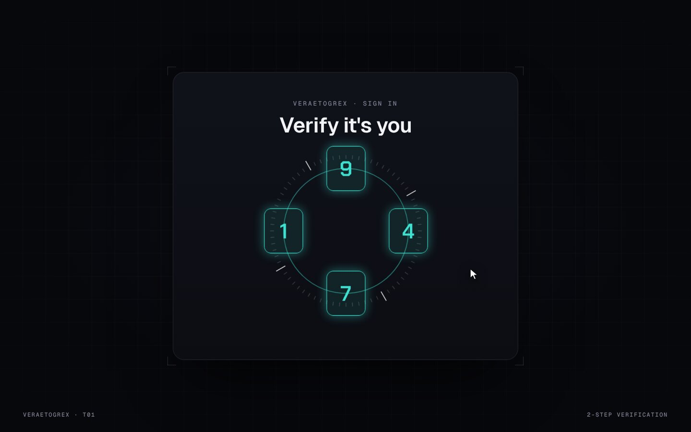

# Orbit OTP

**4 boxes. One orbit. Zero dependencies.**



**Live demo:** [veraetogrex-portfolio.github.io/orbit-otp](https://veraetogrex-portfolio.github.io/orbit-otp/) · **Mockup:** [full-screen version](https://veraetogrex-portfolio.github.io/orbit-otp/mockup/orbit-otp.html)

Type the 4th digit and the row curls onto an orbit, spins 1¼ turns, lights up and screws down into one verified tile. The whole thing stays monochrome until the verdict, so the colour lands on success.

## Use it

Three files, no build step, no dependencies, no web fonts:

```
index.html   markup
style.css    styles and keyframes
script.js    behaviour
```

Download the repo and open `index.html`, or copy the three files into your project.

## Try it

- The demo code is `4719`. Type it or paste it.
- Any other code: the orbit doesn't close, the cells fly back into the row and shake.

## Make it yours

`checkCode` in `script.js` is a stub that compares against `4719`. Replace it with a request to your backend. Colours are CSS custom properties at the top of `style.css`.

`prefers-reduced-motion` is respected: heavy motion drops to short fades.

## What's in `mockup/`

The full 1440×900 screen this component was shot in for the reel:

- `mockup/orbit-otp.html` — interactive. `D` plays the demo, `R` resets.
- `mockup/orbit-otp.autoplay.html` — the scripted ~6 s loop with a drawn cursor.
- URL flags: `?frame` puts the screen in a browser window, `?clean` hides the control panel, `?once` plays the demo once.

The mockup uses a shared stage runtime and bundled fonts from `mockup/_shared/`. The component in the root doesn't need any of it.

---

Component 01 of a series. New one every day on Instagram [@veraetogrex_portfolio](https://www.instagram.com/veraetogrex_portfolio/) · all components: [github.com/veraetogrex-portfolio](https://github.com/veraetogrex-portfolio)

MIT licensed.
